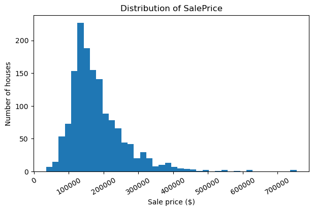
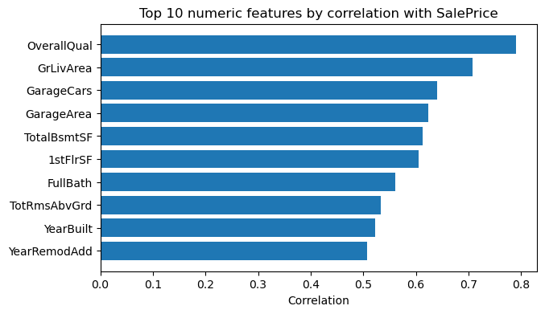
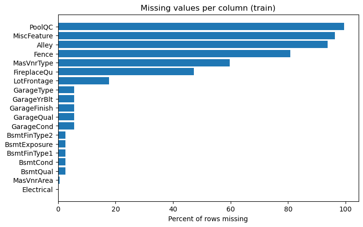
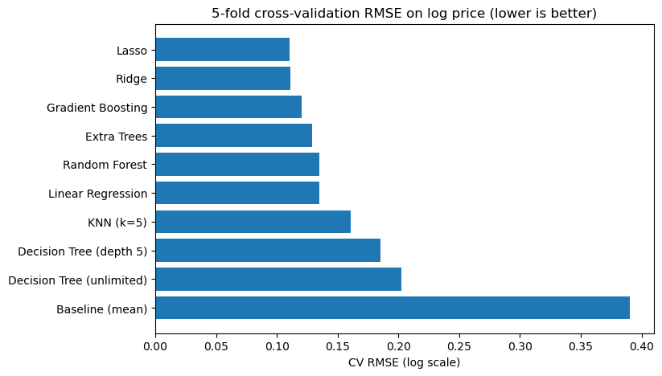
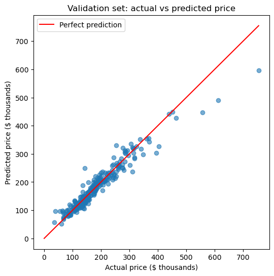
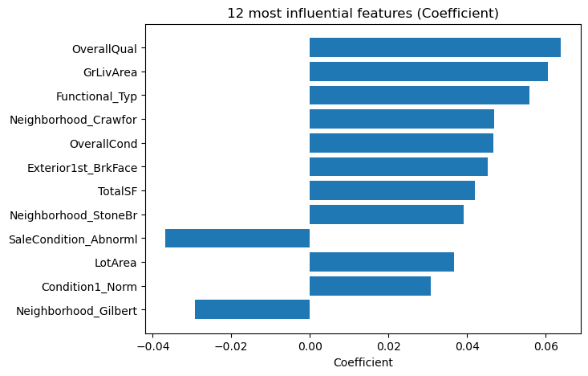

# House Price Prediction

A machine learning project to predict residential house prices using the Ames Housing dataset from Kaggle's House Prices: Advanced Regression Techniques competition.

The project explores the complete regression workflow, from exploratory data analysis and data preprocessing to model comparison, hyperparameter tuning, evaluation, and final prediction generation.

## Project Overview

The objective is to predict the final sale price (`SalePrice`) of residential properties using their structural, geographical, and qualitative characteristics.

The project focuses on understanding the dataset, building a reliable preprocessing workflow, comparing regression algorithms, and selecting a model using cross-validation.

## Dataset

Source: [Kaggle - House Prices: Advanced Regression Techniques](https://www.kaggle.com/competitions/house-prices-advanced-regression-techniques/data)

The dataset contains:
- Training data: 1,460 records and 81 columns.
- Testing data: 1,459 records and 80 columns.
- Target variable: SalePrice.

Download `train.csv` and `test.csv` from Kaggle and place them inside `data/raw/`.

## Project Structure

```text
House-price-prediction/
│
├── data/
│   └── raw/
│       ├── train.csv
│       └── test.csv
│
├── figures_detailed/
│   ├── 01_saleprice_hist.png
│   ├── 04_top10_correlation.png
│   ├── 09_missing_values.png
│   ├── 13_cv_rmse_models.png
│   ├── 16_actual_vs_predicted.png
│   └── ...
│
├── processed_data/
│
├── outputs/
│
├── house_prices_data_preprocessing (1).ipynb
├── model_training_and_evaluation.ipynb
├── submission.csv
├── requirements.txt
├── .gitignore
└── README.md
```

## Machine Learning Workflow

### 1. Data Understanding and Exploratory Data Analysis

- Dataset dimensions and data types.
- Missing-value analysis.
- Statistical summaries.
- SalePrice distribution.
- Numerical feature distributions.
- Correlation analysis.
- Relationship between important features and house prices.

### 2. Data Cleaning and Preprocessing

- Missing-value treatment.
- Handling invalid and inconsistent values.
- Outlier investigation.
- Feature engineering.
- Categorical and numerical feature identification.
- Skewness treatment.
- One-hot encoding.
- Missing-value imputation.
- Standard scaling.
- Scikit-learn preprocessing pipelines.

### 3. Feature Engineering

Important engineered features include:
- TotalSF
- HouseAge
- RemodAge
- TotalBathrooms
- OverallQual-related features

### 4. Model Training and Comparison

The notebook compares the following regression models:

| Model | Configuration |
|---|---|
| Baseline | Mean prediction |
| Linear Regression | Default |
| Ridge Regression | alpha = 10 |
| Lasso Regression | alpha = 0.001 |
| KNN | k = 5 |
| Decision Tree | Unlimited depth |
| Decision Tree | Maximum depth = 5 |
| Random Forest | 200 estimators |
| Extra Trees | 200 estimators |
| Gradient Boosting | 300 estimators |

### 5. Model Evaluation

Models are compared using 5-fold cross-validation.

Evaluation metrics include:
- RMSE
- MAE
- R-squared
- Median percentage error

The selection process prioritizes cross-validation RMSE while keeping validation performance for independent evaluation.

### 6. Hyperparameter Tuning

GridSearchCV is used to tune:
- Ridge Regression
- Lasso Regression
- Gradient Boosting

### 7. Final Predictions

The selected model is refitted using the available training and validation data.

Predictions are transformed back from logarithmic scale and exported to `submission.csv`.

The generated submission contains:
- Id
- SalePrice

## Visualizations

Selected visualizations generated by the project:

### SalePrice Distribution



### Feature Correlation



### Missing Values



### Model Comparison



### Actual vs Predicted Prices



### Feature Importance



## Technologies Used

- Python
- Pandas
- NumPy
- Matplotlib
- Scikit-learn
- Jupyter Notebook

## Installation and Execution

### 1. Clone the repository

```bash
git clone https://github.com/SuhaniMalhotra09/House-price-prediction.git

cd House-price-prediction
```

### 2. Install dependencies

```bash
pip install -r requirements.txt
```

### 3. Download the dataset

Download `train.csv` and `test.csv` from the Kaggle competition and place both files inside:

```text
data/raw/
```

### 4. Launch Jupyter Notebook

```bash
jupyter notebook
```

Open:

`model_training_and_evaluation.ipynb`

Run the notebook cells sequentially.

## Future Improvements

- Experiment with additional boosting algorithms.
- Explore ensemble and stacking techniques.
- Perform further feature selection.
- Improve generalization through repeated cross-validation.
- Optimize the model for Kaggle leaderboard performance.

## Author

Suhani Malhotra

GitHub: [SuhaniMalhotra09](https://github.com/SuhaniMalhotra09)

---

This project is developed for learning and experimentation with end-to-end machine learning and regression techniques.
